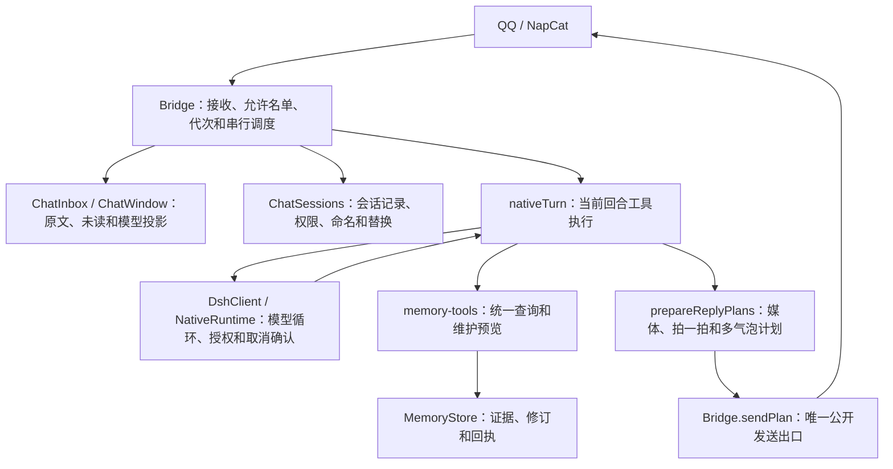

# 当前逻辑地图

本页描述 0.25.0 主线及 2026-10-22 的源码重构。运行行为契约以 `AGENTS.md`、`HANDOFF.md` 和对应版本说明为准；历史版本文档不能覆盖新契约。

## 源码、旧实现和运行资料

日常修改以本仓库为准。`standalone/` 是独立服务主线，`native-dsh-plugin/` 是配套 DSH 工具插件。两者统一打包、安装和探针验证。

`dsh-onebot-source/`、`dsh-group-social/`、`dsh-plugin-memory-source/`、`dsh-companion-voice/`、`dsh-qq-unified/` 是保留的旧插件源码，也仍提供 CQ 解析、安全校验、语音、记忆图等复用实现和回归。不能仅凭“旧目录”判断为死代码。`standalone/lib/legacy-memory/` 保留原记忆核心及来源校验。

部署目录、发布快照、运行数据和工作草稿不作为新的逻辑入口。源码修改不会自动更新已安装版本；发布包通过统一激活指针选择实际运行的服务和插件。

## 主要执行路径

| 领域 | 主要入口 | 必须保留的职责 |
| --- | --- | --- |
| 面板与管理 | `standalone/server.mjs`、`public/app.js` | 本机鉴权、修订检查、管理操作；不能绕过聊天权限 |
| 接收与调度 | `bridge.mjs`、`startup-chat.mjs` | 接收启停、聊天串行、持久化待处理、历史不补答、取消确认 |
| 会话 | `chat-sessions.mjs`、`workspace.mjs` | 统一协议元数据、人格和工作区、权限先于输入、耐重试命名、退休与回滚 |
| 持续聊天 | `continuous-chat.mjs`、`world-simulation.mjs` | 等待事件、真实输入与模拟分离；停止后旧任务不能继续 |
| 角色与离开 | `role-state.mjs`、`absence.mjs`、`handoff.mjs` | 推演先保存、真人空闲计时、交接、同会话整合和恢复 |
| 原生工具 | `native-turn.mjs`、`native-callback.mjs`、`native-dsh-plugin/lib/runtime.mjs` | 回合授权、审批、幂等调用、取消后拒绝写入且等待确认退出 |
| 记忆 | `memory-tools.mjs`、`memory-access.mjs`、`memory-maintenance.mjs`、`memory.mjs`、`lifecycle.mjs` | 共享查询实现；前台读取可记录访问，后台不预热，维护先预览再随 digest 提交 |
| 公开发送 | `reply-control.mjs`、`media.mjs`、`Bridge.sendPlan` | 统一准备计划，发送前重新检查对象与代次，逐条回执，未知结果不重试 |
| 隔离与配置 | `chat-policy.mjs`、`persona-cards.mjs`、`prompt-profiles.mjs`、`voice-profiles.mjs` | 账号/类型/对象/人格隔离，配置文字不能扩大程序权限 |
| 预约 | `scheduled-wake.mjs`、`Bridge.drainScheduledWakes` | 真实 DSH schedule 来源、先持久化去重、原会话唤醒和工具恢复 |
| 发布 | `scripts/package-release.mjs`、`activate-release.mjs`、`install-native-plugin.mjs` | 服务与插件一致、文件哈希、禁用与停止状态、私人数据保护 |

## 会话创建与替换

启动整合和普通消息均调用 `ChatSessions.ensure`。调用者先确认旧执行退出，并提供当前代次检查。模块统一创建完整会话记录，持久化后设置权限、预留命名编号、调用 DSH 命名；失败保留待完成标记供重试。

自动轮换和手动新对话调用 `ChatSessions.replace`。自动轮换继续使用原有持久化 journal。新会话权限及名称就绪、且原会话仍为当前对象时才能提交替换；持久化失败回滚活动记录和退休列表。四个入口统一保存 `transport`，避免原生会话下一次被误当成旧协议。

模块通过状态读取函数访问 Bridge 的当前状态，避免记忆重置回滚替换状态对象后仍引用旧对象。队列、准入、取消确认与轮换回执验证仍由 Bridge 负责。

## 修改应落在哪里

- 新增记忆查询或调整前后台查询语义：修改 `memory-tools.mjs`，再核对原生 schema、阶段允许名单与各调用者的权限门禁。证据写入和最终 digest 继续走原来的独立入口。
- 修改会话字段或初始化顺序：修改 `chat-sessions.mjs`，同时验证启动、普通消息、手动新对话、自动轮换及重启后的下一条输入。
- 修改媒体计划或分气泡展开：修改 `reply-control.mjs` / `media.mjs`；发送节奏、对象验证与回执仍以 `Bridge.sendPlan` 为出口。
- 修改持续对话结束或离开整理：同时核对角色状态、交接、记忆保存回执和持久队列，不能只更改提示词。

## 已知待处理问题

见 [本轮重构记录与后续优先级](REFACTOR-2026-10.md)。尚未完成的长聊容量及性能工作不能据此页宣称已优化。
